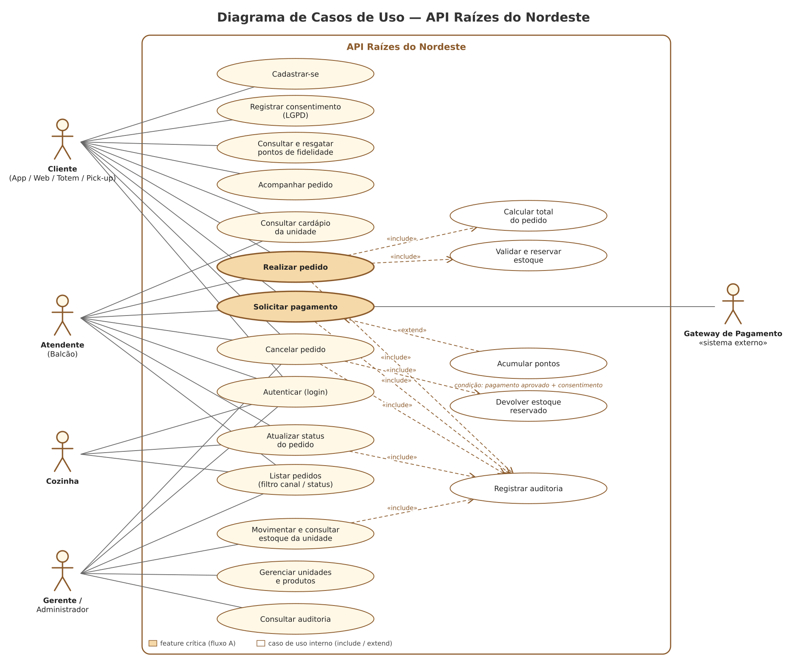

# Casos de Uso — API Raízes do Nordeste

Versão 0.2 — 24/11/2026

> Fonte editável do diagrama: `diagramas/gerar_svg.py` (gera `casos-de-uso.svg`).

## 1. Atores

| Ator | Tipo | Perfil na API | Descrição |
|---|---|---|---|
| Cliente | Primário | `CLIENTE` | Pede pelo App, Web, Totem ou Pick-up. Acompanha pedidos, gerencia consentimento e pontos. |
| Atendente | Primário | `ATENDENTE` | Registra pedidos no balcão, solicita pagamento pelo cliente e marca pedidos como entregues. |
| Cozinha | Primário | `COZINHA` | Consulta a fila de pedidos pagos e avança o preparo. |
| Gerente / Administrador | Primário | `GERENTE`, `ADMIN` | Gerencia unidade, estoque e cancelamentos, e consulta a auditoria. `ADMIN` também gerencia unidades e o catálogo de produtos da rede. |
| Gateway de Pagamento | Secundário (sistema externo) | — | Processa o pagamento e devolve aprovado ou recusado. Na entrega, é um **mock** atrás de uma interface. |

## 2. Casos de uso

| ID | Caso de uso | Atores | Requisitos |
|---|---|---|---|
| UC01 | Cadastrar-se | Cliente | RF01 |
| UC02 | Autenticar (login) | Todos os perfis | RF02, RF03 |
| UC03 | Consultar cardápio da unidade | Cliente, Atendente | RF07 |
| **UC04** | **Realizar pedido** | Cliente, Atendente | RF10, RF11, RF12 |
| **UC05** | **Solicitar pagamento** | Cliente, Atendente, Gateway | RF17, RF18 |
| UC06 | Acompanhar pedido | Cliente | RF14 |
| UC07 | Cancelar pedido | Cliente, Atendente, Gerente | RF16 |
| UC08 | Registrar consentimento (LGPD) | Cliente | RF19 |
| UC09 | Consultar e resgatar pontos | Cliente | RF20, RF21 |
| UC10 | Atualizar status do pedido | Cozinha, Atendente | RF15 |
| UC11 | Listar pedidos (filtro canal/status) | Atendente, Cozinha, Gerente | RF13 |
| UC12 | Gerenciar unidades e produtos | Gerente / Administrador | RF05, RF06 |
| UC13 | Movimentar e consultar estoque | Gerente / Administrador | RF08, RF09 |
| UC14 | Consultar auditoria | Gerente / Administrador | RF23 |
| UC15 | Validar e reservar estoque | «include» de UC04 | RF10 |
| UC16 | Calcular total do pedido | «include» de UC04 | RF12 |
| UC17 | Registrar auditoria | «include» de UC04, UC05, UC07, UC10, UC13 | RF22 |
| UC18 | Acumular pontos | «extend» de UC05 | RF20 |
| UC19 | Devolver estoque reservado | «include» de UC07 | RF16 |

---

## 3. Feature crítica: Realizar Pedido + Solicitar Pagamento

### 3.1 UC04 — Realizar pedido

**Objetivo:** registrar um pedido de uma unidade, por um canal, reservando o estoque dos itens.

**Atores:** Cliente (canais APP, WEB, TOTEM, PICKUP) ou Atendente (canal BALCAO).

**Pré-condições**
1. O ator está autenticado com token JWT válido e perfil `CLIENTE` ou `ATENDENTE`.
2. A unidade existe e está ativa.
3. Os produtos estão cadastrados no cardápio da unidade (seed aplicado).

**Fluxo principal**
1. O ator envia `POST /pedidos` com `unidadeId`, `canalPedido` e a lista de `itens` (`produtoId`, `quantidade`).
2. O sistema valida o formato da requisição: `canalPedido` presente e válido, ao menos 1 item, `quantidade` inteira e maior que zero.
3. O sistema valida se o canal é compatível com o perfil do ator (RN03).
4. O sistema verifica se a unidade existe e está ativa.
5. O sistema verifica se cada produto existe e está disponível no cardápio da unidade.
6. O sistema abre uma **transação** e trava as linhas de estoque dos itens (`SELECT ... FOR UPDATE`).
7. O sistema confere se o saldo cobre a quantidade de cada item (UC15).
8. O sistema calcula o total com o preço vigente no cardápio da unidade e grava o preço unitário em cada item (UC16).
9. O sistema cria o pedido com status `AGUARDANDO_PAGAMENTO`, grava os itens e baixa o estoque com movimentações do tipo `RESERVA`.
10. O sistema registra a auditoria `PEDIDO_CRIADO` (UC17) e confirma a transação.
11. O sistema responde `201 Created` com o pedido: id, status, canal, itens, total e data.

**Fluxos de exceção**

| ID | Situação | Passo | Resposta |
|---|---|---|---|
| E1 | Token ausente ou inválido | pré | `401 NAO_AUTENTICADO` |
| E2 | Perfil sem permissão (ex.: `COZINHA`) | pré | `403 ACESSO_NEGADO` |
| E3 | `canalPedido` ausente ou fora do ENUM; `quantidade` ≤ 0; lista de itens vazia | 2 | `422 VALIDACAO` com `details` por campo |
| E4 | Canal incompatível com o perfil (ex.: `CLIENTE` usando `BALCAO`) | 3 | `422 CANAL_INVALIDO_PARA_PERFIL` |
| E5 | Unidade inexistente ou inativa | 4 | `404 UNIDADE_NAO_ENCONTRADA` |
| E6 | Produto inexistente ou fora do cardápio da unidade | 5 | `404 PRODUTO_NAO_ENCONTRADO` |
| E7 | Saldo insuficiente em um ou mais itens | 7 | `409 ESTOQUE_INSUFICIENTE`, com o item e o saldo disponível em `details`; **rollback**, nada é gravado |

**Pós-condições (sucesso)**
- O pedido fica persistido em `AGUARDANDO_PAGAMENTO`, com o canal registrado.
- O estoque dos itens fica reservado, ou seja, baixado com movimentação `RESERVA`.
- Há um registro de auditoria da criação.

---

### 3.2 UC05 — Solicitar pagamento

**Objetivo:** pedir ao gateway externo o pagamento do pedido, registrar a tentativa e atualizar o status.

**Atores:** Cliente (dono do pedido) ou Atendente (da unidade do pedido); Gateway de Pagamento (secundário).

**Pré-condições**
1. O ator está autenticado e tem permissão sobre o pedido.
2. O pedido existe e está em `AGUARDANDO_PAGAMENTO`.

**Fluxo principal**
1. O ator envia `POST /pagamentos` com `pedidoId` e `tokenPagamento`, mais o cabeçalho `Idempotency-Key`.
2. O sistema verifica a chave de idempotência. Se ela já tiver um resultado final registrado, devolve esse resultado sem cobrar de novo (RN08).
3. O sistema valida o pedido: se existe, se pertence ao ator e se está em `AGUARDANDO_PAGAMENTO`.
4. O sistema cria o registro de pagamento como `PENDENTE`, com o valor igual ao **total do pedido** e o payload enviado.
5. O sistema chama o gateway pela interface `PaymentGateway`.
6. O gateway responde **APROVADO**.
7. O sistema grava o pagamento como `APROVADO` com o payload recebido e muda o pedido para `PAGO`.
8. O sistema registra a auditoria `PAGAMENTO_APROVADO` e `STATUS_ALTERADO` (UC17).
9. **[extend UC18]** Se o pedido tem cliente identificado com consentimento de fidelidade ativo, o sistema credita os pontos.
10. O sistema responde `201 Created` com o pagamento (id, status, valor, data) e o novo status do pedido.

**Fluxos alternativos**

| ID | Situação | Comportamento |
|---|---|---|
| A1 | Gateway responde **RECUSADO** | Pagamento gravado como `RECUSADO`, com o motivo. O pedido **continua** em `AGUARDANDO_PAGAMENTO` e o estoque continua reservado. Resposta `201` com `status: RECUSADO` e uma mensagem clara. O ator pode tentar de novo com uma nova `Idempotency-Key`. |
| A2 | **3ª recusa** no mesmo pedido | Além de A1, o pedido vai para `CANCELADO`, o estoque reservado é devolvido (UC19, movimentação `ESTORNO_RESERVA`) e a auditoria registra `PEDIDO_CANCELADO` (motivo: limite de tentativas). |
| A3 | Timeout ou falha do gateway | Pagamento gravado como `ERRO`; o pedido não muda. Resposta `502 GATEWAY_INDISPONIVEL`. O resultado não é guardado na idempotência, então dá para repetir com a mesma chave. |
| A4 | Mesma `Idempotency-Key` repetida | Retorna `200` com o mesmo pagamento já registrado, sem chamar o gateway de novo. |

**Fluxos de exceção**

| ID | Situação | Resposta |
|---|---|---|
| E1 | Token ausente ou inválido | `401 NAO_AUTENTICADO` |
| E2 | Pedido de outro cliente, ou perfil sem permissão | `403 ACESSO_NEGADO` |
| E3 | `pedidoId` ou `tokenPagamento` ausente | `422 VALIDACAO` |
| E4 | Pedido inexistente | `404 PEDIDO_NAO_ENCONTRADO` |
| E5 | Pedido já `PAGO`, `CANCELADO` ou em outro status | `409 PEDIDO_NAO_AGUARDA_PAGAMENTO` |

**Pós-condições**
- Toda tentativa fica registrada na tabela de pagamentos, com status, payloads e data.
- Pagamento aprovado: pedido em `PAGO` e, se houver consentimento, pontos creditados.
- Pagamento recusado: pedido continua aguardando pagamento até a 3ª recusa, quando é cancelado e o estoque volta.

---

## 4. Regras de negócio

| ID | Regra |
|---|---|
| RN01 | `canalPedido` é obrigatório, com um destes valores: `APP`, `TOTEM`, `BALCAO`, `PICKUP`, `WEB`. |
| RN02 | Todo pedido pertence a exatamente uma unidade e só aceita produtos do cardápio dessa unidade. |
| RN03 | `BALCAO` é exclusivo do perfil `ATENDENTE`. `CLIENTE` usa `APP`, `WEB`, `TOTEM` ou `PICKUP`. |
| RN04 | No pedido do `CLIENTE`, o cliente vem do token e qualquer `clienteId` no corpo é ignorado. No pedido do `ATENDENTE`, `clienteId` é opcional: com ele o cliente fica identificado para a fidelidade; sem ele, o pedido é anônimo (minimização LGPD). |
| RN05 | O total é sempre calculado no back-end. O preço unitário é gravado no item, para que uma mudança de preço não altere pedidos antigos. |
| RN06 | **O estoque é reservado na criação do pedido**, na mesma transação que cria o pedido (tudo ou nada). |
| RN07 | O estoque reservado é devolvido em dois casos: no cancelamento e na 3ª recusa de pagamento. |
| RN08 | O `POST /pagamentos` exige `Idempotency-Key`. Uma chave com resultado final (`APROVADO` ou `RECUSADO`) não gera nova cobrança. |
| RN09 | O mock decide de forma determinística pelo `tokenPagamento`: `tok_aprovado` → APROVADO, `tok_recusado` → RECUSADO, `tok_timeout` → falha do gateway. Isso imita os tokens de teste dos gateways reais. |
| RN10 | O valor cobrado é sempre o total do pedido; nenhum valor enviado pelo cliente é usado. |
| RN11 | Máquina de estados e quem pode executar cada transição (qualquer outra transição → `409 TRANSICAO_INVALIDA`): |

| De | Para | Quem |
|---|---|---|
| `AGUARDANDO_PAGAMENTO` | `PAGO` | Somente o sistema, via pagamento aprovado |
| `PAGO` | `EM_PREPARO` | `COZINHA` |
| `EM_PREPARO` | `PRONTO` | `COZINHA` |
| `PRONTO` | `ENTREGUE` | `ATENDENTE` |
| `AGUARDANDO_PAGAMENTO` | `CANCELADO` | `CLIENTE` (próprio pedido), `ATENDENTE`, `GERENTE`, ou o sistema na 3ª recusa |
| `PAGO` | `CANCELADO` | Somente `GERENTE`. O estorno do pagamento fica **documentado como proposta**. |

| ID | Regra |
|---|---|
| RN12 | Toda criação, cancelamento, mudança de status, resultado de pagamento e movimentação manual de estoque gera um registro de auditoria: quem, ação, entidade, id, data/hora, antes/depois. |
| RN13 | Pontos de fidelidade só são creditados a clientes com consentimento ativo para a finalidade "fidelidade". |

## 5. Decisões registradas

| Decisão | Escolha | Justificativa |
|---|---|---|
| Momento da baixa de estoque | **Reserva na criação do pedido** | Em horário de pico, evita que o cliente pague por um item que acabou enquanto pagava. Garante a consistência com uma transação única e travamento de linha (`FOR UPDATE`), sem condição de corrida. |
| Pagamento recusado | Pedido continua aguardando e só é cancelado na 3ª recusa | Equilibra a experiência do cliente (permite tentar outro cartão) com a liberação do estoque. A expiração da reserva por tempo fica documentada como proposta (exigiria um job agendado). |
| Regra do mock | `tokenPagamento` determinístico | O corretor consegue reproduzir aprovado, recusado e falha sem depender de acaso. |
| Canal × perfil | `BALCAO` só para `ATENDENTE` | Mantém a rastreabilidade por canal coerente com quem de fato atendeu. |
