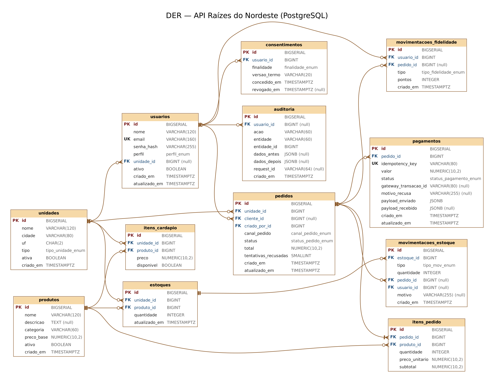
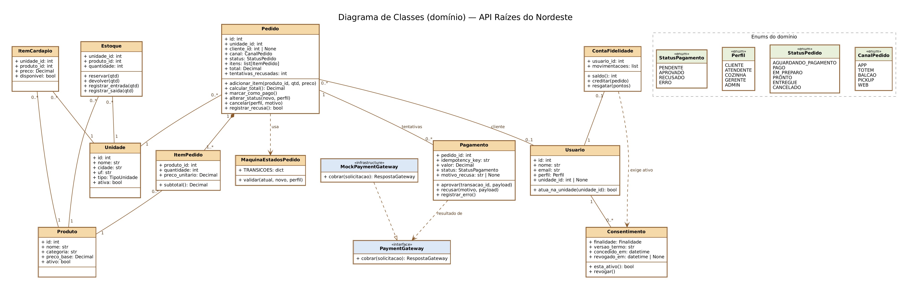
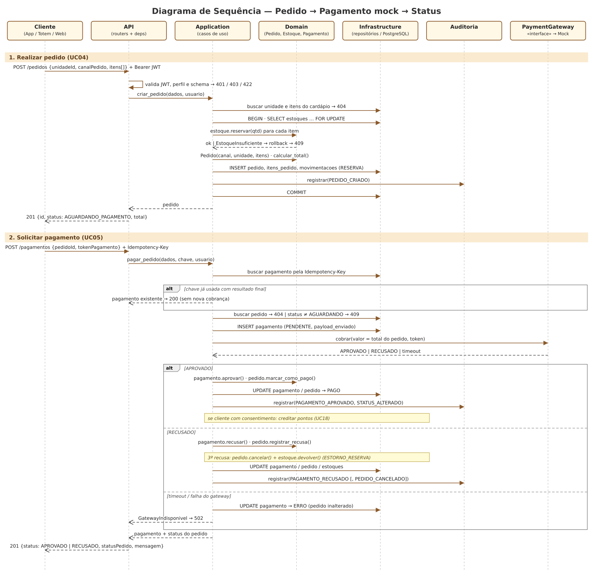

# Modelagem — API Raízes do Nordeste

Versão 0.3 — 24/11/2026

Este documento reúne o **DER**, o **diagrama de classes** e o **diagrama de sequência** do fluxo crítico. Ele complementa as regras de negócio (RN01–RN13) de [`casos-de-uso.md`](casos-de-uso.md).

> As imagens são geradas pelos scripts em `docs/diagramas/` (`gerar_der.py`, `gerar_classes.py`, `gerar_sequencia.py`). Se o modelo mudar, edite o script e gere a imagem de novo. Isso mantém o DER compatível com o banco real, como o roteiro exige.

---

## 1. DER

**Notação (pé-de-galinha):** `||` = exatamente um · `o|` = zero ou um · `o<` = zero ou muitos · `|<` = um ou muitos.

### 1.1 Relacionamentos e cardinalidades

| Relacionamento | Cardinalidade | Leitura |
|---|---|---|
| unidades → usuarios | 0..1 : 0..N | Funcionário (ATENDENTE, COZINHA, GERENTE) pertence a uma unidade; CLIENTE e ADMIN não pertencem a nenhuma (`unidade_id` nulo). |
| unidades → itens_cardapio ← produtos | 1 : N / N : 1 | Associação N:N entre unidade e produto, com preço e disponibilidade próprios da unidade. |
| unidades → estoques ← produtos | 1 : N / N : 1 | **Cada unidade tem seu próprio estoque** de cada produto. |
| estoques → movimentacoes_estoque | 1 : N | Histórico de toda entrada, saída, reserva e estorno. |
| unidades → pedidos | 1 : N | Todo pedido pertence a exatamente uma unidade (RN02). |
| usuarios → pedidos (cliente) | 0..1 : N | Pedido de balcão pode ser anônimo (RN04). |
| pedidos → itens_pedido | 1 : 1..N | Pedido tem ao menos um item. |
| produtos → itens_pedido | 1 : N | |
| pedidos → pagamentos | 1 : 0..N | **Pagamento desacoplado**: cada tentativa é um registro próprio. |
| usuarios → consentimentos | 1 : N | Histórico de concessões e revogações por finalidade e versão do termo. |
| usuarios → movimentacoes_fidelidade | 1 : N | Extrato de pontos; o saldo é a soma. |
| usuarios → auditoria | 0..1 : N | Ações do sistema (ex.: cancelamento na 3ª recusa) ficam com `usuario_id` nulo. |

Duas FKs ficam fora do desenho para não poluir a imagem, mas existem no banco: `pedidos.criado_por_id → usuarios.id` e `movimentacoes_estoque.usuario_id → usuarios.id`.

### 1.2 Restrições relevantes

| Tabela | Restrição | Motivo |
|---|---|---|
| usuarios | `UNIQUE(email)` | Login único |
| itens_cardapio | `UNIQUE(unidade_id, produto_id)` · `CHECK(preco > 0)` | Um produto aparece uma vez por cardápio |
| estoques | `UNIQUE(unidade_id, produto_id)` · `CHECK(quantidade >= 0)` | O banco também impede estoque negativo, como segunda barreira depois do domínio |
| movimentacoes_estoque | `CHECK(quantidade > 0)` | O sentido vem do `tipo` |
| pedidos | `CHECK(total >= 0)` · `CHECK(tentativas_recusadas BETWEEN 0 AND 3)` | RN05, regra das 3 recusas |
| itens_pedido | `UNIQUE(pedido_id, produto_id)` · `CHECK(quantidade > 0)` | Quantidades do mesmo produto são somadas em um único item |
| pagamentos | `UNIQUE(idempotency_key)` · `CHECK(valor > 0)` | RN08 (idempotência) |
| consentimentos | `UNIQUE(usuario_id, finalidade, versao_termo)` | Um aceite por versão do termo |

### 1.3 Índices

| Índice | Atende a |
|---|---|
| `pedidos(canal_pedido, status)` | `GET /pedidos?canalPedido=&status=` (RF13) |
| `pedidos(unidade_id, status)` | Fila da cozinha e do balcão por unidade |
| `pedidos(cliente_id)` | "Meus pedidos" |
| `pagamentos(pedido_id)` | Tentativas de um pedido |
| `auditoria(entidade, entidade_id)` | Histórico de um pedido na consulta de auditoria |

### 1.4 Tipos enumerados (ENUM no PostgreSQL)

| Enum | Valores |
|---|---|
| `perfil_enum` | CLIENTE, ATENDENTE, COZINHA, GERENTE, ADMIN |
| `canal_pedido_enum` | APP, TOTEM, BALCAO, PICKUP, WEB |
| `status_pedido_enum` | AGUARDANDO_PAGAMENTO, PAGO, EM_PREPARO, PRONTO, ENTREGUE, CANCELADO |
| `status_pagamento_enum` | PENDENTE, APROVADO, RECUSADO, ERRO |
| `tipo_mov_enum` | ENTRADA, SAIDA, RESERVA, ESTORNO_RESERVA |
| `tipo_unidade_enum` | COMPLETA, REDUZIDA |
| `finalidade_enum` | FIDELIDADE, MARKETING |
| `tipo_fidelidade_enum` | CREDITO, RESGATE |

### 1.5 Decisões de modelagem

| Decisão | Justificativa |
|---|---|
| **`itens_cardapio` separado de `estoques`** | Cardápio responde *o que a unidade vende e por quanto*, e é responsabilidade do ADMIN. Estoque responde *quanto há*, e é responsabilidade do GERENTE. Separar mantém as permissões e o histórico independentes. |
| **Preço no cardápio da unidade** (`produtos.preco_base` é só a referência) | Atende à variação regional de preço e receita citada no estudo de caso. O pedido usa sempre `itens_cardapio.preco`. |
| **`preco_unitario` e `subtotal` copiados em `itens_pedido`** | Uma mudança de preço no cardápio não altera o valor de pedidos antigos (RN05). |
| **Estoque como saldo + movimentações** | `estoques.quantidade` permite consulta rápida, e `movimentacoes_estoque` garante a rastreabilidade de entradas, saídas, reservas e estornos. As duas são atualizadas na mesma transação. |
| **Pagamento em tabela própria, 1:N com pedido** | Deixa o pagamento desacoplado do pedido e guarda todas as tentativas, com os payloads enviado e recebido em JSONB. |
| **Idempotência pela coluna única `idempotency_key`** | O banco garante que não haja duas cobranças com a mesma chave, mesmo com requisições simultâneas. Uma tentativa com `ERRO` é reprocessada no mesmo registro. |
| **Fidelidade como extrato** (`movimentacoes_fidelidade`), sem coluna de saldo | O saldo é calculado (soma de créditos menos resgates), o que evita inconsistência e já forma um histórico auditável. |
| **Consentimento com finalidade, versão e revogação** | É a evidência exigida pela LGPD: *quem* aceitou, *o quê*, *qual versão* e *quando*, com revogação sem apagar o histórico. |
| **Minimização LGPD em `usuarios`** | Coleta só nome, e-mail e senha (hash). CPF, telefone e data de nascimento ficam de fora, porque o MVP não precisa deles. |
| **Auditoria com `dados_antes` e `dados_depois` em JSONB** | Um formato genérico serve para qualquer entidade. Dados pessoais são mascarados antes da gravação. |
| **Datas em `TIMESTAMPTZ`** | A rede está em várias cidades e o horário fica sempre em UTC. |

---

## 2. Diagrama de classes (domínio)

As regras de negócio ficam **nas classes de domínio**, e não nos routers:

| Regra | Onde mora |
|---|---|
| Estoque não pode ficar negativo (RN06) | `Estoque.reservar()` lança `EstoqueInsuficiente` |
| Total calculado no back-end (RN05) | `Pedido.calcular_total()` e `ItemPedido.subtotal()` |
| Transições de status e perfil permitido (RN11) | `MaquinaEstadosPedido.validar()`, chamada por `Pedido.alterar_status()` e `Pedido.cancelar()` |
| Cancelamento na 3ª recusa (A2) | `Pedido.registrar_recusa()` devolve `True` ao atingir o limite |
| Fidelidade só com consentimento (RN13) | `ContaFidelidade.creditar()` exige `Consentimento.esta_ativo()` |
| Funcionário só atua na própria unidade | `Usuario.atua_na_unidade()` |
| Pagamento desacoplado | `PaymentGateway` (interface no domínio) e `MockPaymentGateway` (implementação em `infrastructure/payment`) |

**Mapeamento para o código (seção 6 do escopo):**

| Camada | Pasta | Conteúdo |
|---|---|---|
| Domain | `app/domain/` | Classes acima, enums e exceções de domínio. **Não importa FastAPI nem SQLAlchemy.** |
| Application | `app/application/` | Casos de uso: `criar_pedido`, `pagar_pedido`, `alterar_status`, `cancelar_pedido`, `movimentar_estoque` |
| Infrastructure | `app/infrastructure/` | Models SQLAlchemy (tabelas do DER), repositórios, `MockPaymentGateway`, gravação de auditoria |
| API | `app/api/` | Routers, schemas Pydantic, `deps.py` (sessão, usuário logado, perfis), `errors.py` (erro padrão) |

---

## 3. Diagrama de sequência — fluxo crítico

Pontos que o diagrama evidencia:
- **Validação em camadas:** a API valida token, perfil e formato (401/403/422). A aplicação orquestra, e o domínio decide as regras (409).
- **Transação única** na criação do pedido: `BEGIN`, travamento do estoque com `FOR UPDATE`, reserva, inserts, auditoria e `COMMIT`. Qualquer falha faz rollback de tudo.
- **Idempotência antes de qualquer cobrança.**
- **O gateway só é acessado pela interface**, e as três respostas possíveis têm tratamento explícito.
- **Auditoria** em todas as ações sensíveis: criação, resultado do pagamento, mudança de status e cancelamento.
